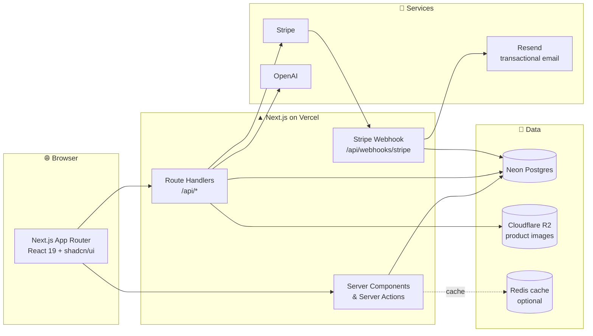
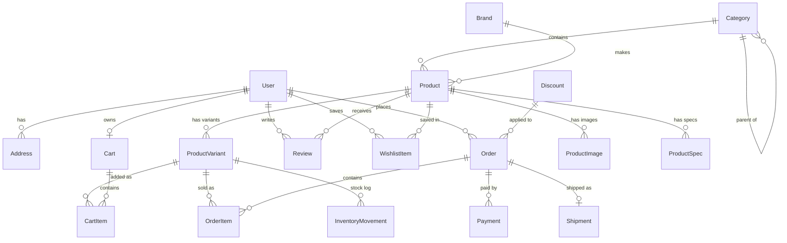
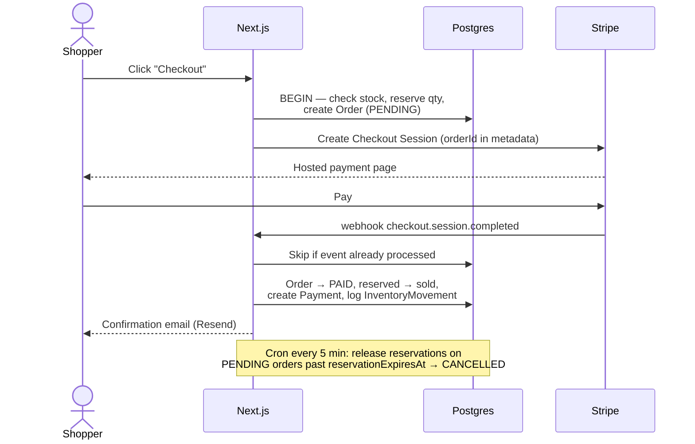
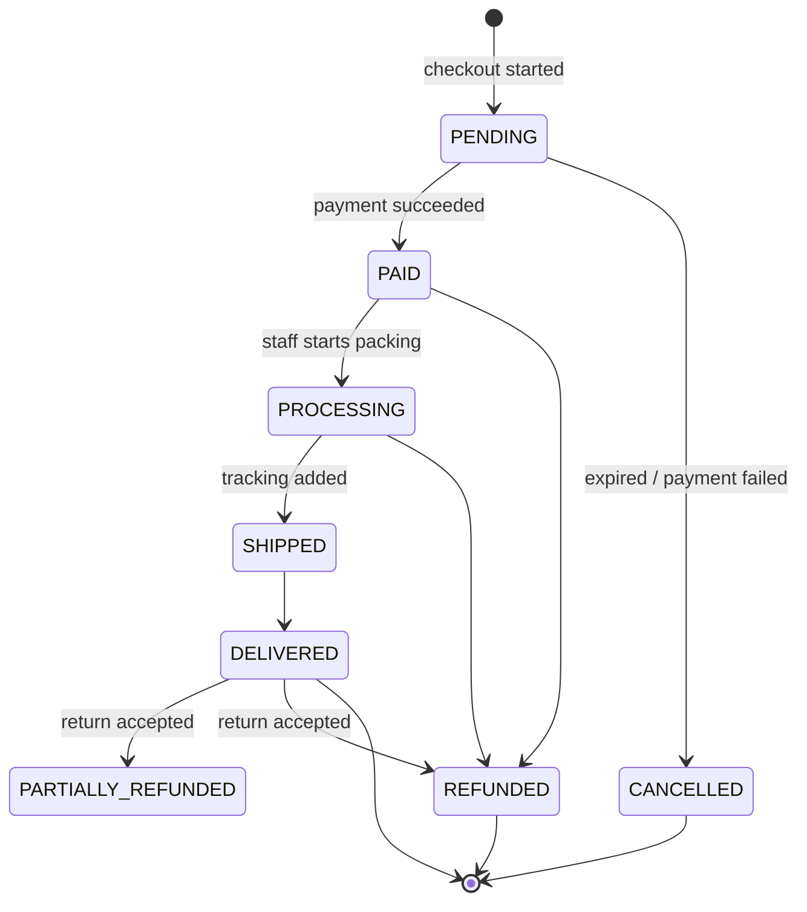

# ⚡ Modun Electronics — Project Overview

> An online store for consumer electronics: browse, compare, buy and track orders, with an admin dashboard to run the catalog, inventory and fulfilment.

| | |
|---|---|
| **Status** | 📝 Planning |
| **Type** | B2C e-commerce web app (desktop + mobile web) |
| **Stack** | Next.js 16 · React 19 · TypeScript · Prisma 7 · Neon Postgres · Auth.js v5 · Stripe · Cloudflare R2 · Tailwind v4 + shadcn/ui |
| **Last updated** | 2026-11-12 |

---

## 📚 Table of Contents

1. [Problem & Goals](#-problem--goals)
2. [Users](#-users)
3. [Features](#-features)
4. [Architecture](#-architecture)
5. [Data Model (Prisma)](#-data-model-prisma)
6. [Key Flows](#-key-flows)
7. [Routes](#-routes)
8. [Tech Stack](#-tech-stack)
9. [UI / UX](#-ui--ux)
10. [Engineering Rules](#-engineering-rules)
11. [Roadmap](#-roadmap)
12. [Open Questions](#-open-questions)

---

## 🎯 Problem & Goals

Buying electronics online is spec-heavy and trust-sensitive. Shoppers want to:

- Compare products side by side on the specs that matter (RAM, storage, screen size, battery…)
- Know a product is **actually in stock** before paying
- See clear pricing, warranty and delivery info
- Track an order after checkout without calling the store

**Modun** gives shoppers a fast, filterable catalog with trustworthy stock and a smooth checkout, and gives the business one dashboard to manage products, inventory and orders.

### Success metrics

| Metric | Target (first 90 days) |
|---|---|
| Checkout conversion (cart → paid) | ≥ 3% of sessions with a cart |
| Oversold orders | 0 |
| Product page LCP | < 2.5 s on 4G mobile |
| Order status questions to support | Decreasing month over month |

---

## 👥 Users

| Persona | Needs |
|---|---|
| 🛒 **Shopper (guest)** | Browse, search, filter and buy without being forced to create an account |
| 👤 **Registered customer** | Saved addresses, order history, wishlist, faster checkout, reviews |
| 🔍 **Spec-focused buyer** | Detailed specs, side-by-side compare, filters by attribute |
| 🧑‍💼 **Store admin** | Manage products, variants, prices, stock, orders, refunds, discounts |
| 📦 **Fulfilment staff** | See paid orders, pack, add tracking, mark shipped |

---

## ✨ Features

### A. 🗂️ Catalog

- **Categories** (nested): Phones → Smartphones, Laptops, Audio → Headphones, Accessories, etc.
- **Brands** with logo and brand page
- **Products** with title, description (Markdown), images, specs, warranty info
- **Variants** per product (e.g. *iPhone · 256 GB · Black*), each with its own SKU, price, compare-at price and stock
- **Specs as structured attributes** (key/value with units) so they can power filters and comparison
- Product status: `DRAFT` → `ACTIVE` → `ARCHIVED`

### B. 🔎 Search & Discovery

- Full-text search across title, brand, category and specs
- Faceted filters: price range, brand, category, in-stock only, and spec attributes (RAM, storage, screen size…)
- Sort: relevance, price ↑/↓, newest, best rated
- ⚖️ **Compare** up to 4 products side by side
- Recently viewed, related products, "frequently bought together" (later)

### C. 🛍️ Cart & Checkout

- Persistent cart for guests (cookie session) and signed-in users; carts merge on sign-in
- Discount codes (percentage or fixed amount, with expiry and usage limits)
- Shipping address + shipping method selection
- Payment through **Stripe Checkout** (cards, Apple Pay, Google Pay)
- Stock is **reserved** when checkout starts and released if payment doesn't complete
- Order confirmation email + page

### D. 📦 Orders & Accounts

- Order history and order detail with status timeline
- Shipment tracking number + carrier link
- Saved addresses, profile, password change
- ❤️ Wishlist
- ⭐ Reviews and ratings (verified-purchase badge)
- Returns / refund requests (Phase 2)

### E. 🧑‍💼 Admin Dashboard (`/admin`)

- Products: create/edit, variants, images (drag to reorder), specs, publish/archive
- Inventory: stock per variant, low-stock alerts, stock adjustment log
- Orders: list with filters, status changes, add tracking, issue full/partial refunds via Stripe
- Customers: list, order history
- Discounts: create and manage codes
- Dashboard: revenue, orders, top products, low stock

### F. 🔐 Authentication

- Email/password and Google sign-in (Auth.js v5)
- Guest checkout supported
- Roles: `CUSTOMER`, `STAFF`, `ADMIN`

### G. 🤖 AI Features (Phase 3)

- Shopping assistant: "Which laptop under $1,000 is best for video editing?" answered from the live catalog
- AI-generated product description drafts and spec extraction from manufacturer sheets (admin)
- Review summaries ("Customers say…")

---

## 🏗️ Architecture



**Principles**

- One Next.js repo for storefront, admin and API — less overhead
- Server Components for catalog pages (fast, SEO-friendly); Server Actions for cart and admin mutations
- **Stripe webhooks are the source of truth for payment** — never mark an order paid from the redirect page
- Product images served from R2 through a CDN with Next.js `<Image>`

---

## 🗄️ Data Model (Prisma)

### Entity relationships



### `schema.prisma`

> 💡 Money is stored as **integer minor units** (cents) to avoid floating-point errors. `OrderItem` stores a **snapshot** of name, SKU and price so past orders don't change when the catalog does.

```prisma
generator client {
  provider = "prisma-client"
  output   = "../src/generated/prisma"
}

datasource db {
  provider = "postgresql"
  // Connection URL lives in prisma.config.ts (Prisma 7)
}

// ─────────────────────────────── Enums ───────────────────────────────

enum Role {
  CUSTOMER
  STAFF
  ADMIN
}

enum ProductStatus {
  DRAFT
  ACTIVE
  ARCHIVED
}

enum OrderStatus {
  PENDING      // created, awaiting payment
  PAID
  PROCESSING   // being packed
  SHIPPED
  DELIVERED
  CANCELLED
  REFUNDED
  PARTIALLY_REFUNDED
}

enum PaymentStatus {
  PENDING
  SUCCEEDED
  FAILED
  REFUNDED
}

enum DiscountType {
  PERCENTAGE
  FIXED_AMOUNT
}

enum InventoryReason {
  RESTOCK
  SALE
  RESERVATION
  RESERVATION_RELEASE
  RETURN
  ADJUSTMENT
}

// ─────────────────────────── Auth (Auth.js) ───────────────────────────

model User {
  id               String    @id @default(cuid())
  name             String?
  email            String    @unique
  emailVerified    DateTime?
  image            String?
  passwordHash     String?
  role             Role      @default(CUSTOMER)
  stripeCustomerId String?   @unique
  createdAt        DateTime  @default(now())
  updatedAt        DateTime  @updatedAt

  accounts  Account[]
  sessions  Session[]
  addresses Address[]
  orders    Order[]
  cart      Cart?
  reviews   Review[]
  wishlist  WishlistItem[]
}

model Account {
  id                String  @id @default(cuid())
  userId            String
  type              String
  provider          String
  providerAccountId String
  refresh_token     String? @db.Text
  access_token      String? @db.Text
  expires_at        Int?
  token_type        String?
  scope             String?
  id_token          String? @db.Text
  session_state     String?

  user User @relation(fields: [userId], references: [id], onDelete: Cascade)

  @@unique([provider, providerAccountId])
}

model Session {
  id           String   @id @default(cuid())
  sessionToken String   @unique
  userId       String
  expires      DateTime
  user         User     @relation(fields: [userId], references: [id], onDelete: Cascade)
}

model VerificationToken {
  identifier String
  token      String   @unique
  expires    DateTime

  @@unique([identifier, token])
}

model Address {
  id         String  @id @default(cuid())
  userId     String
  fullName   String
  phone      String?
  line1      String
  line2      String?
  city       String
  region     String?
  postalCode String?
  country    String  // ISO 3166-1 alpha-2
  isDefault  Boolean @default(false)

  user User @relation(fields: [userId], references: [id], onDelete: Cascade)

  @@index([userId])
}

// ────────────────────────────── Catalog ──────────────────────────────

model Category {
  id        String     @id @default(cuid())
  name      String
  slug      String     @unique
  parentId  String?
  sortOrder Int        @default(0)

  parent   Category?  @relation("CategoryTree", fields: [parentId], references: [id])
  children Category[] @relation("CategoryTree")
  products Product[]
}

model Brand {
  id       String    @id @default(cuid())
  name     String    @unique
  slug     String    @unique
  logoUrl  String?
  products Product[]
}

model Product {
  id            String        @id @default(cuid())
  title         String
  slug          String        @unique
  description   String        @db.Text // Markdown
  status        ProductStatus @default(DRAFT)
  warrantyMonths Int?
  categoryId    String
  brandId       String
  ratingAvg     Float         @default(0)  // denormalized for sorting
  ratingCount   Int           @default(0)
  createdAt     DateTime      @default(now())
  updatedAt     DateTime      @updatedAt

  category Category         @relation(fields: [categoryId], references: [id])
  brand    Brand            @relation(fields: [brandId], references: [id])
  variants ProductVariant[]
  images   ProductImage[]
  specs    ProductSpec[]
  reviews  Review[]
  wishlistedBy WishlistItem[]

  @@index([categoryId, status])
  @@index([brandId])
}

model ProductVariant {
  id             String  @id @default(cuid())
  productId      String
  sku            String  @unique
  name           String  // e.g. "256 GB · Black"
  options        Json    // { "storage": "256 GB", "color": "Black" }
  priceCents     Int
  compareAtCents Int?    // original price for "sale" display
  currency       String  @default("USD")
  stock          Int     @default(0) // on hand
  reserved       Int     @default(0) // held by open checkouts
  lowStockAt     Int     @default(5)
  isActive       Boolean @default(true)

  product            Product             @relation(fields: [productId], references: [id], onDelete: Cascade)
  cartItems          CartItem[]
  orderItems         OrderItem[]
  inventoryMovements InventoryMovement[]

  @@index([productId])
}

model ProductImage {
  id        String  @id @default(cuid())
  productId String
  url       String  // R2 public URL
  alt       String?
  sortOrder Int     @default(0)

  product Product @relation(fields: [productId], references: [id], onDelete: Cascade)

  @@index([productId])
}

model ProductSpec {
  id        String  @id @default(cuid())
  productId String
  group     String? // "Display", "Battery", "Connectivity"
  key       String  // "screen_size"
  label     String  // "Screen size"
  value     String  // "6.1"
  unit      String? // "in"

  product Product @relation(fields: [productId], references: [id], onDelete: Cascade)

  @@unique([productId, key])
  @@index([key, value]) // powers spec filters
}

model InventoryMovement {
  id        String          @id @default(cuid())
  variantId String
  delta     Int             // +10 restock, -1 sale
  reason    InventoryReason
  orderId   String?
  note      String?
  createdBy String?         // admin user id
  createdAt DateTime        @default(now())

  variant ProductVariant @relation(fields: [variantId], references: [id])

  @@index([variantId, createdAt])
}

// ─────────────────────────── Cart & Wishlist ─────────────────────────

model Cart {
  id         String     @id @default(cuid())
  userId     String?    @unique // null for guest carts
  guestToken String?    @unique // cookie value for guests
  updatedAt  DateTime   @updatedAt

  user  User?      @relation(fields: [userId], references: [id], onDelete: Cascade)
  items CartItem[]
}

model CartItem {
  id        String @id @default(cuid())
  cartId    String
  variantId String
  quantity  Int

  cart    Cart           @relation(fields: [cartId], references: [id], onDelete: Cascade)
  variant ProductVariant @relation(fields: [variantId], references: [id])

  @@unique([cartId, variantId])
}

model WishlistItem {
  userId    String
  productId String
  addedAt   DateTime @default(now())

  user    User    @relation(fields: [userId], references: [id], onDelete: Cascade)
  product Product @relation(fields: [productId], references: [id], onDelete: Cascade)

  @@id([userId, productId])
}

// ─────────────────────────────── Orders ──────────────────────────────

model Order {
  id              String      @id @default(cuid())
  number          Int         @unique @default(autoincrement()) // human-friendly #1042
  userId          String?     // null for guest orders
  email           String
  status          OrderStatus @default(PENDING)
  currency        String      @default("USD")
  subtotalCents   Int
  discountCents   Int         @default(0)
  shippingCents   Int         @default(0)
  taxCents        Int         @default(0)
  totalCents      Int
  discountId      String?
  shippingAddress Json        // snapshot
  stripeCheckoutSessionId String? @unique
  reservationExpiresAt    DateTime?
  createdAt       DateTime    @default(now())
  updatedAt       DateTime    @updatedAt

  user     User?       @relation(fields: [userId], references: [id])
  discount Discount?   @relation(fields: [discountId], references: [id])
  items    OrderItem[]
  payments Payment[]
  shipment Shipment?

  @@index([userId, createdAt])
  @@index([status, createdAt])
}

model OrderItem {
  id             String @id @default(cuid())
  orderId        String
  variantId      String
  // Snapshot at time of purchase
  productTitle   String
  variantName    String
  sku            String
  unitPriceCents Int
  quantity       Int

  order   Order          @relation(fields: [orderId], references: [id], onDelete: Cascade)
  variant ProductVariant @relation(fields: [variantId], references: [id])

  @@index([orderId])
}

model Payment {
  id                    String        @id @default(cuid())
  orderId               String
  stripePaymentIntentId String        @unique
  amountCents           Int
  refundedCents         Int           @default(0)
  status                PaymentStatus @default(PENDING)
  createdAt             DateTime      @default(now())

  order Order @relation(fields: [orderId], references: [id])
}

model Shipment {
  id             String    @id @default(cuid())
  orderId        String    @unique
  carrier        String
  trackingNumber String
  shippedAt      DateTime  @default(now())
  deliveredAt    DateTime?

  order Order @relation(fields: [orderId], references: [id])
}

model Discount {
  id          String       @id @default(cuid())
  code        String       @unique
  type        DiscountType
  value       Int          // percent (e.g. 10) or cents
  minSubtotalCents Int?
  maxUses     Int?
  usedCount   Int          @default(0)
  startsAt    DateTime?
  endsAt      DateTime?
  isActive    Boolean      @default(true)
  orders      Order[]
}

// ─────────────────────────────── Reviews ─────────────────────────────

model Review {
  id         String   @id @default(cuid())
  productId  String
  userId     String
  rating     Int      // 1–5
  title      String?
  body       String?  @db.Text
  isVerified Boolean  @default(false) // bought this product
  createdAt  DateTime @default(now())

  product Product @relation(fields: [productId], references: [id], onDelete: Cascade)
  user    User    @relation(fields: [userId], references: [id], onDelete: Cascade)

  @@unique([productId, userId]) // one review per product per user
}

// Stripe webhook idempotency
model ProcessedWebhookEvent {
  id          String   @id // Stripe event id
  type        String
  processedAt DateTime @default(now())
}
```

### `prisma.config.ts`

```ts
import "dotenv/config";
import { defineConfig, env } from "prisma/config";

export default defineConfig({
  schema: "prisma/schema.prisma",
  migrations: { path: "prisma/migrations" },
  datasource: { url: env("DATABASE_URL") },
});
```

---

## 🔄 Key Flows

### Checkout & payment



### Order lifecycle



**Available stock = `stock − reserved`.** Reservation and release run in a single transaction with a conditional update (`WHERE stock - reserved >= qty`) so two buyers can never buy the last unit.

---

## 🧭 Routes

### Storefront

| Route | Page |
|---|---|
| `/` | Home: hero, featured categories, deals, new arrivals |
| `/c/[...slug]` | Category listing with filters (e.g. `/c/audio/headphones`) |
| `/brands/[slug]` | Brand page |
| `/p/[slug]` | Product detail page |
| `/search?q=` | Search results with facets |
| `/compare?ids=` | Side-by-side comparison |
| `/cart` | Cart |
| `/checkout/success` · `/checkout/cancel` | Post-payment pages |
| `/account` · `/account/orders/[number]` · `/account/addresses` · `/account/wishlist` | Customer account |
| `/sign-in` · `/sign-up` | Auth |

### Admin (role-gated)

| Route | Page |
|---|---|
| `/admin` | Dashboard |
| `/admin/products` · `/admin/products/[id]` | Product list / editor |
| `/admin/inventory` | Stock levels and adjustments |
| `/admin/orders` · `/admin/orders/[number]` | Order management |
| `/admin/customers` | Customers |
| `/admin/discounts` | Discount codes |

### API

| Route | Purpose |
|---|---|
| `POST /api/webhooks/stripe` | Payment events (signature-verified) |
| `POST /api/uploads` | Presigned R2 upload URL (admin only) |
| `GET /api/cron/release-reservations` | Release expired holds (Vercel Cron) |
| `POST /api/ai/assistant` | Shopping assistant (Phase 3) |

---

## 🧰 Tech Stack

| Layer | Choice | Docs |
|---|---|---|
| Framework | **Next.js 16** (App Router) + **React 19** | [nextjs.org/docs](https://nextjs.org/docs) |
| Language | **TypeScript** (strict) | [typescriptlang.org](https://www.typescriptlang.org/docs/) |
| Database | **Neon** serverless Postgres | [neon.com/docs](https://neon.com/docs) |
| ORM | **Prisma 7** | [prisma.io/docs](https://www.prisma.io/docs) |
| Auth | **Auth.js v5** (NextAuth) — credentials + Google | [authjs.dev](https://authjs.dev) |
| Payments | **Stripe Checkout** + webhooks | [docs.stripe.com/payments/checkout](https://docs.stripe.com/payments/checkout) |
| File storage | **Cloudflare R2** (S3-compatible) | [developers.cloudflare.com/r2](https://developers.cloudflare.com/r2/) |
| Email | **Resend** + React Email | [resend.com/docs](https://resend.com/docs) |
| Styling | **Tailwind CSS v4** + **shadcn/ui** | [tailwindcss.com/docs](https://tailwindcss.com/docs) · [ui.shadcn.com](https://ui.shadcn.com) |
| Icons | **Lucide** | [lucide.dev](https://lucide.dev) |
| Validation | **Zod** (forms, Server Actions, API) | [zod.dev](https://zod.dev) |
| Search | Postgres full-text search (`tsvector`) to start; Meilisearch/Algolia if needed | [postgresql.org — FTS](https://www.postgresql.org/docs/current/textsearch.html) |
| Cache | Redis (Upstash) — *optional, add when needed* | [upstash.com/docs](https://upstash.com/docs/redis) |
| AI | OpenAI (Phase 3) | [platform.openai.com/docs](https://platform.openai.com/docs) |
| Hosting | **Vercel** (+ Vercel Cron) | [vercel.com/docs](https://vercel.com/docs) |

### Environment variables

```bash
DATABASE_URL=            # Neon pooled connection string
AUTH_SECRET=
AUTH_GOOGLE_ID=
AUTH_GOOGLE_SECRET=
STRIPE_SECRET_KEY=
STRIPE_WEBHOOK_SECRET=
NEXT_PUBLIC_STRIPE_PUBLISHABLE_KEY=
R2_ACCOUNT_ID=
R2_ACCESS_KEY_ID=
R2_SECRET_ACCESS_KEY=
R2_BUCKET=
R2_PUBLIC_URL=
RESEND_API_KEY=
CRON_SECRET=
OPENAI_API_KEY=          # Phase 3
```

---

## 🎨 UI / UX

### General

- Clean, modern, product-first — let the photos and specs do the work
- **Light mode default**, dark mode optional (shoppers, not developers)
- Generous whitespace, clear price hierarchy, strong "Add to cart" CTA
- References: [Apple Store](https://www.apple.com/store), [Best Buy](https://www.bestbuy.com), [Nothing](https://nothing.tech)

### Layout

- **Header:** logo · search bar · category mega-menu · account · cart (with item count)
- **Category page:** filter sidebar (collapses to a sheet on mobile) + product grid
- **Product page:** image gallery · title/brand/rating · variant picker · price · stock badge · add to cart · tabs for *Overview / Specs / Reviews*
- **Cart:** slide-over drawer for quick view, full `/cart` page for editing
- **Admin:** sidebar navigation + data tables (shadcn `DataTable`)

### Status & badge colors

| State | Color | Lucide icon |
|---|---|---|
| ✅ In stock | `#10b981` emerald | `PackageCheck` |
| ⚠️ Low stock | `#f59e0b` amber | `AlertTriangle` |
| ⛔ Out of stock | `#ef4444` red | `PackageX` |
| 🏷️ On sale | `#ec4899` pink | `Tag` |
| 🆕 New | `#3b82f6` blue | `Sparkles` |

### Category icons (Lucide)

| Category | Icon |
|---|---|
| Phones | `Smartphone` |
| Laptops | `Laptop` |
| Tablets | `Tablet` |
| Audio | `Headphones` |
| TVs & Monitors | `Monitor` |
| Cameras | `Camera` |
| Gaming | `Gamepad2` |
| Wearables | `Watch` |
| Accessories | `Cable` |

### Responsive

- **Mobile-first** for the storefront (most shoppers browse on phones); desktop-first for admin
- Sticky "Add to cart" bar on mobile product pages
- Filters open as a bottom sheet on mobile

### Micro-interactions

- Smooth transitions and hover states on product cards (second image on hover)
- Toast on add-to-cart, wishlist, and admin saves
- Loading skeletons for grids and product pages
- Optimistic cart updates

---

## 📏 Engineering Rules

> ⚠️ **NEVER use `prisma db push` or edit the database structure directly.** All schema changes go through migrations: `prisma migrate dev` locally, then `prisma migrate deploy` in production.

- 💵 Store all money as integer cents; format only in the UI
- 🔐 Stripe webhooks are the only thing that marks an order `PAID`; verify signatures and record event IDs for idempotency
- 📦 Every stock change writes an `InventoryMovement` row
- 🧾 Order items are snapshots — never join back to live product data to display a past order
- ✅ Validate every Server Action and API input with Zod
- 🛡️ Check role on the server for every `/admin` page and admin action (not just in middleware/proxy)
- 🖼️ Images upload straight to R2 with presigned URLs; never through the app server

---

## 🗺️ Roadmap

| Phase | Scope |
|---|---|
| **0 · Foundation** | Repo, Tailwind/shadcn, Prisma + Neon, Auth.js, base layout, seed data |
| **1 · MVP store** | Catalog, product pages, search & filters, cart, Stripe checkout, webhooks, order emails, account + order history, basic admin (products, stock, orders) |
| **2 · Growth** | Reviews, wishlist, compare, discount codes, returns/refunds, low-stock alerts, admin dashboard metrics, SEO (sitemap, structured data) |
| **3 · Smart features** | AI shopping assistant, AI description drafts, review summaries, recommendations |

---

## ❓ Open Questions

1. **Market & currency** — Where will Modun sell, and in which currency? This decides payment providers (Stripe availability varies by country; local options such as QPay may be needed in Mongolia), tax handling and shipping carriers.
2. **Inventory source** — Will stock live only in this app, or sync with a warehouse/POS system?
3. **Shipping** — Flat rate, weight-based, or live carrier rates? Store pickup?
4. **Taxes** — Manual rates per region or Stripe Tax?
5. **Marketplace?** — Is Modun the only seller, or will third-party sellers list products later? (Would require a `Seller` model and payouts.)
6. **Used/refurbished items** — Needed? Would add a `condition` field to variants.
7. **Languages** — English only, or multilingual (e.g. English + Mongolian)?
